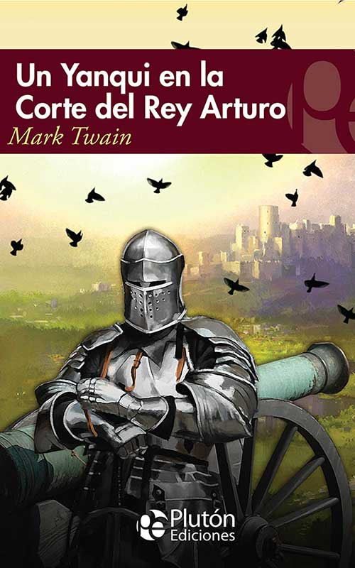
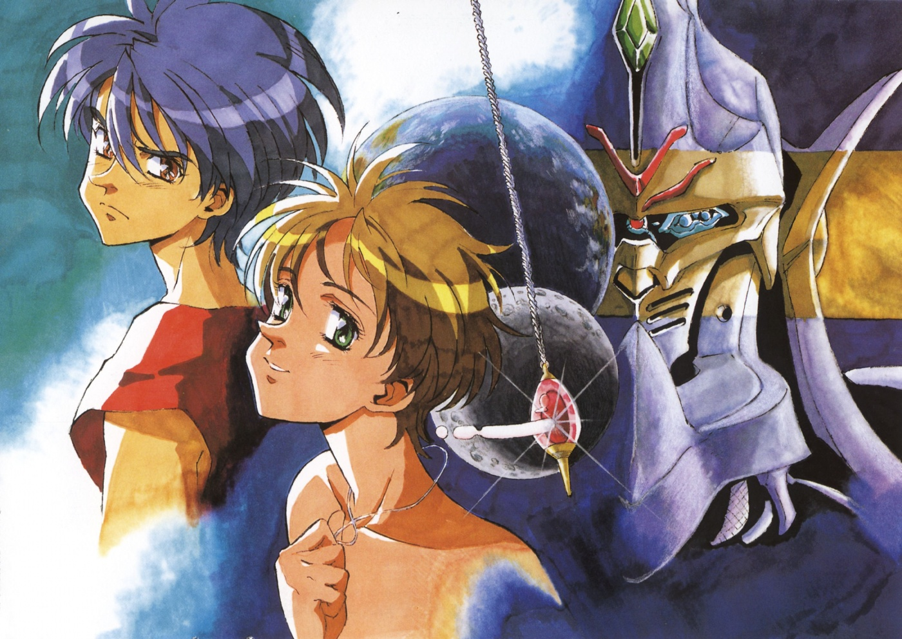
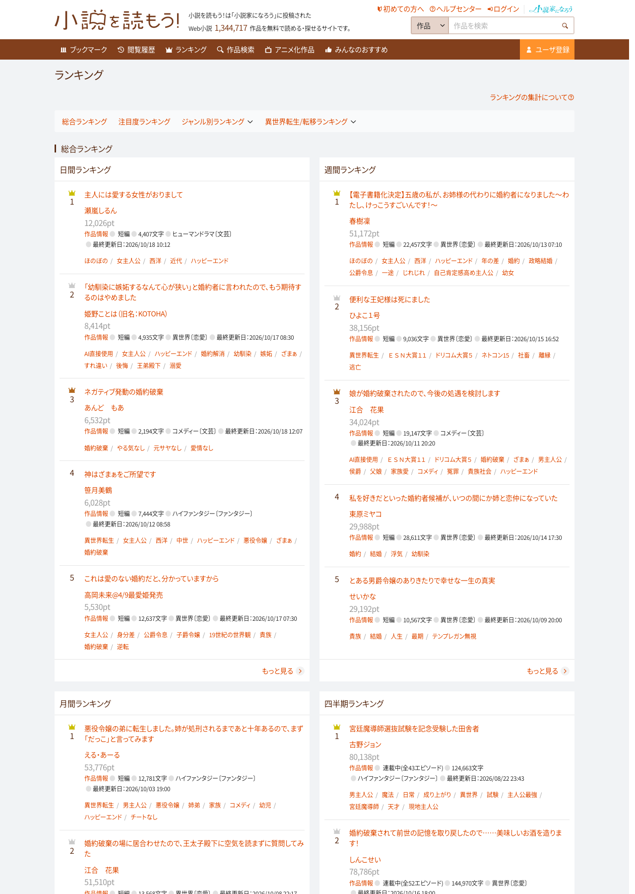
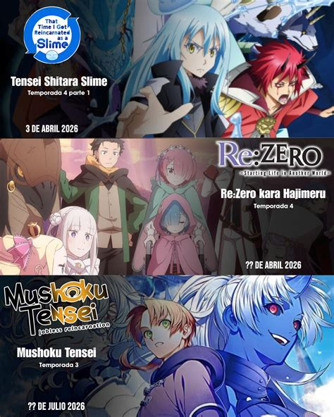
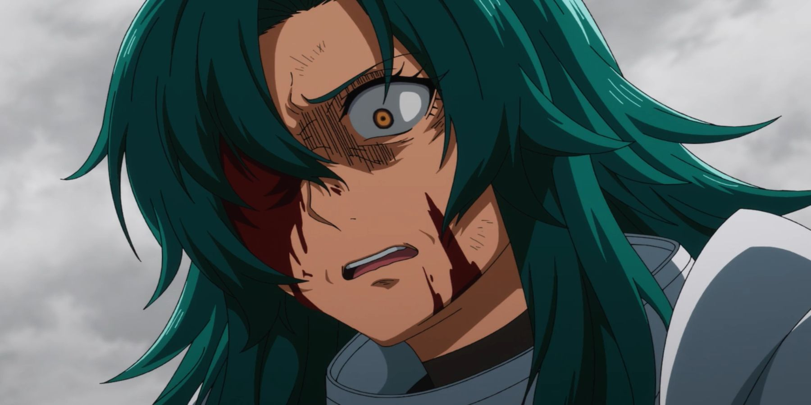
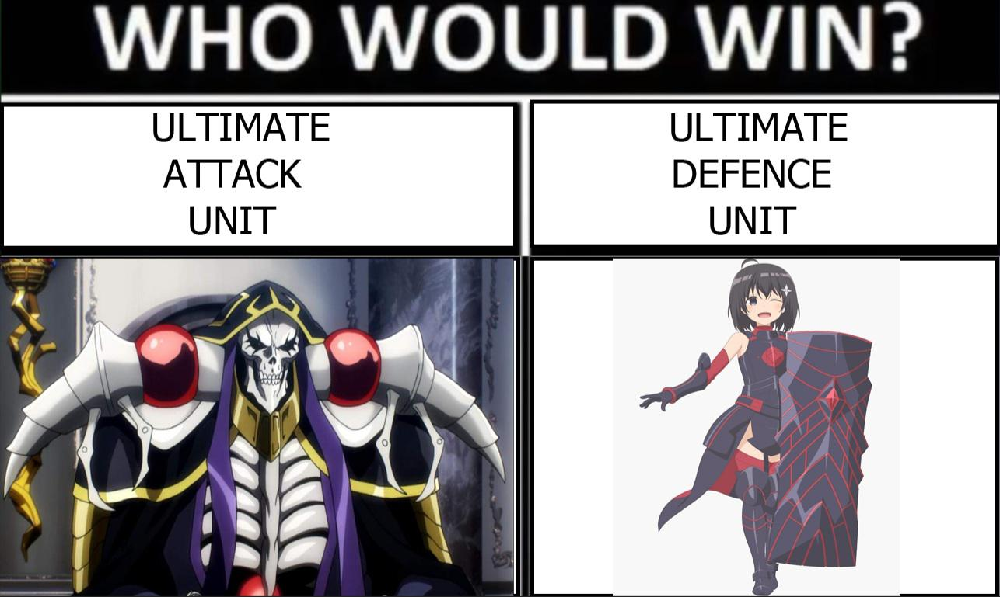
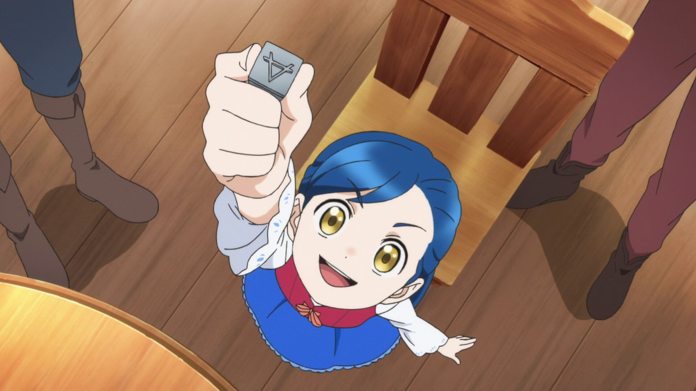

La idea de ser transportado a un mundo de fantasía, o a uno con reglas distintas a las nuestras, lleva mucho tiempo latente dentro del imaginario colectivo. Ahí están *Alicia en el país de las maravillas* (1865), *El mago de Oz* (1900) y *Las crónicas de Narnia* (1950). Y uno de los primeros ejemplos del truco de "uso lo que sé para ganar" es *Un yanqui en la corte del rey Arturo*, de Mark Twain (1889), un libro que amo, donde un ingeniero despierta en la Inglaterra medieval y se pone a aplicar su tecnología para mandar en el lugar. Así que eso que hoy llamamos isekai no es tan nuevo: el cliché tiene más de un siglo, y lo que cambió fue lo que se hace con él.

<figure>

<figcaption>

*Un yanqui en la corte del rey Arturo*, de Mark Twain (portada de la edición de Plutón Ediciones)

</figcaption>

</figure>

En el anime también hay antecedentes de sobra, solo que venían escondidos en el boom del momento. *Aura Battler Dunbine* (1983) ya mandaba a un motociclista a otro mundo (y no de la forma en que solitos ellos lo hacen), pero lo importante eran mechas. *Magic Knight Rayearth* (1994) mezclaba tres chicas invocadas, magia y robots gigantes, así que era maho shoujo, mecha y hasta space opera --esas de CLAMP no se andaban con nimiedades y le apostaban a todo lo que estaba de moda en una sola serie--. Y en 1996 llegó ***Tenkuu no Escaflowne***, la primera serie que muchos recuerdan ya directamente como isekai: otra chica transportada a un mundo de fantasía, aunque todavía había mechas, tragedia y guerra. Desde mi perspectiva es ahí cuando empezó el ascenso del **isekai**, porque toda ola empieza con una pequeña onda. Y sé que es vieja como para inspirar obras nuevas, pero los autores que vinieron después ni siquiera tuvieron que verla: les bastó ver series de alguien que sí, y como toda fotocopia de fotocopia, se fue perdiendo el detalle. Lo que sobrevivió fue el truco de entrada, la puerta, y no lo que había detrás.

<figure>

<figcaption>

Van, Hitomi y el Escaflowne en arte promocional de *The Vision of Escaflowne* (1996)

</figcaption>

</figure>

El verdadero boom llegó a partir de los 2010, con *Sword Art Online* (2012) --sí, ya sé que en teoría no es isekai, pero la idea es la misma-- y *Log Horizon* (2013), y de ahí ya no hubo vuelta atrás. Hoy hay isekais hasta debajo de las piedras, es como si en algún lugar de Japón existiera un curso de escritura creativa cuyo primer ejercicio es *escribe una historia sobre qué harías si reencarnaras en otro mundo*, y todos los alumnos terminaron publicando su tarea en una novela web. Es la única explicación razonable que se me ocurre.

En realidad, la cosa no anda tan lejos: el género creció en plataformas donde cualquiera publica gratis y los lectores votan (la más famosa es Shōsetsuka ni Narō), y los rankings premian lo que engancha rápido. "Imagina qué harías si renacieras" engancha rápido, porque es fácil de escribir, fácil de leer y todos lo hemos fantaseado alguna vez. Fue en esas plataformas de donde salen el oficinista que muere atropellado (el famoso *Camión-kun*) y los títulos que son una sinopsis completa, porque, hay que contar de qué va la cosa para que te lean, por ejemplo: 信じていた仲間達にダンジョン奥地で殺されかけたがギフト『無限ガチャ』でレベル9999の仲間達を手に入れて元パーティーメンバーと世界に復讐＆『ざまぁ！』します！ (que viene siendo más o menos algo así como: *«Mis compañeros de confianza casi me matan en lo más profundo de la mazmorra, pero con el don "Gacha infinito" conseguí compañeros de nivel 9999 y me vengaré de mi antiguo grupo y del mundo. ¡Y bien merecido lo tienen!»*). Es un título, no una sinopsis.

Bueno, pues resulta que luego las editoriales usan esos rankings como buscador de talento ya validado (porque qué hueva andar leyendo algo que voy a publicar), y de ahí se brinca a la novela ligera, al manga, al anime, películas, juegos, y un largo etcétera.

<figure>

<figcaption>

Rankings diario y semanal de Shōsetsuka ni Narō (captura del 20 de octubre de 2026)

</figcaption>

</figure>

Y aquí es donde las productoras abusan. Como todos sabemos en esto del anime suelen ir tras el dinero más que tras dejar huella en la historia, y un isekai genérico, con un prota súper OP en un mundo de fantasía donde las morritas se le lanzan nomás porque sí, sale más barato de hacer y deja más lana que una historia compleja y profunda que exige altos estándares de animación, pacing y diseño de audio con cuidado, y que seguramente no venderá tanto. Peor aún: contrario a lo que uno podría pensar muchas veces el anime no es más que un comercial largo de la novela, así que no necesita ser memorable, le basta con vender libros. Y no me lo estoy inventando: según [Mangashed](https://mangashed.com/how-many-isekai-anime-are-there/), que cita una encuesta de Aniplex, en 2022 los isekais fueron más del 20 % de todo el anime nuevo. Para ponerlo en perspectiva, [Facts.net](https://facts.net/anime-genres/) lista 34 géneros de anime, entre ellos mecha, deportes, misterio, música y vampiros, y el isekai es solo uno de ellos.

Es decir, si $n = 34$ es el número total de géneros disponibles y $p = 0.20$ la proporción asignada a los isekai.

La distribución se define como:

$$
P(i) =
\begin{cases}
p, & i = 1 \\
\dfrac{1-p}{n-1}, & 2 \leq i \leq n
\end{cases}
$$

Para $n = 34$ y $p = 0.20$:

$$
P(i) =
\begin{cases}
20\%, & i = 1 \\
\dfrac{80\%}{33} \approx 2.4242\%, & 2 \leq i \leq 34
\end{cases}
$$

La suma de todas las proporciones es:

$$
20\% + 33\left(\frac{80\%}{33}\right) = 100\%
$$

Más de una quinta parte de la oferta para uno de 34 géneros, mientras que los otros 33 solo tienen opción a 2.4242% cada uno (si fuera justo, pero sabemos que habrá géneros que se quedarán sin nada) es un exceso.

Hay una analogía que me gusta mucho: siempre hay muchas moscas sobre la basura, y eso no significa que sepa buena. Que algo sea popular no lo hace bueno. Eso sí, un poquito de calidad sí debería haber, ¿no? Y la hay: de los mismos portales de novelas web salieron joyas como **Mushoku Tensei**, **Re:Zero** y **Tensei Shitara Slime**. Lo bueno está, solo que revuelto con el ruido. Un medidor útil, aunque no infalible, son las temporadas: casi ningún isekai genérico pasa de una, mientras que Rimuru, por ejemplo, ya terminó su cuarta. Y digo que no es infalible porque hay casos como el de *Saga of Tanya the Evil* que es buenísima (aunque no a muchos los convenza su animación) y tardó casi diez años en tener su segunda temporada. Las temporadas dicen si el negocio sobrevivió; la calidad de la obra es otra cuestión.

<figure>

<figcaption>

Tensei Shitara Slime, Re:Zero y Mushoku Tensei, las joyas del género.

</figcaption>

</figure>

Entonces, ¿qué separa lo bueno de la basura? Muchos pensarían que es el desarrollo del personaje principal o una buena historia que contar. Personalmente creo que depende de que el mundo se resista y de que alguien más, aparte del protagonista, importe. El poder del protagonista y lo original de la premisa pesan menos. Tomen, por ejemplo, **The Wrong Way to Use Healing Magic**, genérico a más no poder: un estudiante transportado por error a un mundo de fantasía, con una magia de curación que todos creen débil pero realmente está bien cheeteado. Lo que lo cambia es Rose, quien entrena al prota. Fue comandante de batallón, renunció a su rango cuando murieron sus subordinados (Auru murió protegiéndola) y tiene una cicatriz en el ojo que se niega a curar. La sanadora más poderosa que no se cura a sí misma para recordar sus errores. Una sola capa de historia, que te cuentan en un capitulo y medio, convierte a la mentora ruda de manual en el corazón de la serie. Y justo es eso, darle peso a un personaje secundario, algo que *How Not to Summon a Demon Lord* o *In Another World with My Smartphone* nunca se atrevieron a hacer. Ojito ahí, no digo que cualquier giro sea bueno, ni que convertirá el carbón en un diamante, pero uno bien puesto vuelve --cuando menos-- interesante lo que era genérico, y de paso hace que el mundo deje de ser solo un escenario para el protagonista.

<figure>

<figcaption>

Rose, de *The Wrong Way to Use Healing Magic*, con el rostro herido y gesto de angustia al ver a sus subordinados muertos

</figcaption>

</figure>

Lo mismo pasa con los protagonistas invulnerables, que no es el problema por sí mismo; lo es cuando la invulnerabilidad es todo lo que hay. En **Overlord**, Ainz es prácticamente invencible, pero lo interesante es la distancia entre lo que es (un oficinista con ansiedad, improvisando sobre la marcha) y lo que todos creen que es (un estratega supremo cuyos planes son "demasiado profundos" para entenderlos), además de cómo su cuerpo le va apagando la empatía sin que se dé cuenta. Por otro lado, en **Bofuri**, Maple pone todo en defensa porque no quiere que le duela nada, así que su poder sale de su carácter y no del cielo. Es *comfort food*, y hasta para eso hace falta estilo. No como tantos otros protas olvidables que literal ganan por el poder del guión.

<figure>

<figcaption>

Ainz contra Maple, el ataque definitivo contra la defensa definitiva (meme publicado en Reddit por [u/Beonette](https://www.reddit.com/user/Beonette))

</figcaption>

</figure>

Algo parecido ocurre con el conocimiento moderno, el otro tropo favorito del género. Comparen **Ascendance of a Bookworm** con **How a Realist Hero Rebuilt the Kingdom**: Realist Hero tiene un mundo mucho más amplio (diversas especies, naciones, culturas), pero Bookworm, en un entorno cerrado (solo algunas ciudades de Ehrenfest y la academia real), logró uno más vivo. Porque ahí cada pieza empuja contra Myne: no tiene materiales, ni dinero, ni salud, y hay gremios y jerarquías que le cierran puertas, así que lograr cualquier objetivo es puro ensayo y error, y debe valerse incluso de artimañas de comerciante para lograr lo que quiere. En cambio, cuando el mundo reacciona como hoja de cálculo (aplicas la medida y sube el indicador), igual que en Realist Hero, la escala es escenografía. El defecto de muchos isekais es tratar el conocimiento como un truco de videojuego: dices "rotación de cultivos" y todos se maravillan.

<figure>

<figcaption>

Myne, de *Ascendance of a Bookworm*, alzando sonriente uno de los tipos móviles de metal que Johann por fin logró fabricar para la imprenta

</figcaption>

</figure>

En los tres casos pasa lo mismo: hay un costo, y casi siempre es lo primero que se pierde en la fotocopia.

Otra cosa que he notado es que parece que todo tiene que ser alguien de otro mundo que llega a un mundo de fantasía, en vez de una fantasía hecha desde cero. Tiene su lógica: un protagonista que no sabe nada es una forma cómoda de explicar el mundo, y construir uno original cuesta más, en trabajo del autor y en presupuesto. Pero afortunadamente la fantasía "de siempre" sigue viva: *Sousou no Frieren* y *Dungeon Meshi* fueron éxitos enormes, y ninguna necesita a un viajero del mundo moderno. Si dos de las más celebradas de los últimos años van por ahí, a lo mejor el público sí lo pide, y quien no se anima es el que pone el dinero.

En fin, así como hubo una era de los mechas y otra de los romcoms, la de los isekais también va a pasar (espero). Eso sí, los géneros rara vez mueren; se vuelven nicho.

Si me tocara apostar por el siguiente, miraría el ranking de Narō de hoy: en los primeros puestos del diario y del semanal casi todo son romances de fantasía, con compromisos rotos, hijas nobles traicionadas y villanas reencarnadas --telenovela time--. Que tampoco es un género que haya salido de la nada. Ya estaba asomándose entre el boom de los isekais (*Bakarina*), igual que los antecedentes del propio isekai lo estuvieron entre otras modas, y podría ir ganando tracción poco a poco hasta volverse el dominante. No se lo tomen como pronóstico serio, las cosas pueden cambiar, pues entre un ranking web y el anime suelen pasar años. Pero si algo aprendimos aquí es que las olas empiezan como simples ondas.

Eso sí, la nostalgia también está vendiendo mucho, y eso ya no es adivinar. *Keroro Gunsō* está en emisión con reparto nuevo y, según [Anime News Network](https://www.animenewsnetwork.com/news/2025-12-23/sgt-frog-manga-gets-tv-anime-with-brand-new-cast-next-fall/.232427), habrá película por el 20.º aniversario. También ya hay remake de *Magic Knight Rayearth* (Guerreras Mágicas), y de *Ranma ½*, y se está animando otra vez *Dragon Ball Super*. Hasta *Naruto*, al parecer, renacerá de entre las cenizas (y de paso descanonizaría a Boruto). A lo mejor volvemos a los animes de antes, o más bien a los que los adultos vemos con nostalgia.

En fin. Los géneros van y vienen, pero solo *Detective Conan*, *Sazae-san* y *One Piece* son eternos. Amén.
