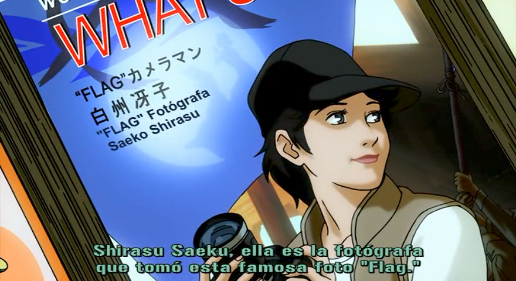

Tengo una carpeta con archivos `.ass` que no abro desde hace más de quince años. Los abrí el otro día para ver si seguían ahí, y sí: abren igual, con la misma tipografía que ya no tengo instalada y los mismos tiempos que ajusté a mano en alguna madrugada. De todo lo que hice en esa época —los foros, los servidores, los discos que se murieron— es lo único que sigue funcionando sin pedir permiso.

Mi primer intento de fansub fue el OVA de _Quiz Magic Academy_, en 2008. Desde el primer archivo quise que se notara el trabajo, porque cuando trabajas solo la única carta de presentación es lo que sueltas. Mi fansub nunca fue de los grandes: nada de series populares ni de proyectos llamativos. Lo mío eran las series que nadie subtitulaba, las olvidadas y abandonadas. Un año después empecé _Pani Poni Dash!_, que se volvió el proyecto insignia de ese catálogo.

## La cadena

Para entender por qué esto era trabajo vale la pena ver de dónde venía. El fansub más viejo del que hay registro es de 1986: un episodio de _Lupin III_ hecho en una Amiga. Se hacía con un **genlock**, un aparato que mezclaba la señal de video con la de la computadora para sobreimprimir el texto, y el resultado se grababa en un máster S-VHS. De ahí se sacaban copias, y cada copia perdía calidad, así que había tapes de decimoquinta generación que se veían como si los hubieran filmado a través de un vaso de agua. Los programas de esos años eran JACOsub en Amiga y Sub Station Alpha en Windows.

Cuando yo entré, todo eso ya era --monte-- digital (en 2008 el VHS era arqueología para cualquiera con internet) y el proceso se había vuelto una línea de producción de un solo hombre. Primero el **raw**: el episodio sin subtítulos, y conseguir uno bueno era una ruleta rusa. A veces entrabas a Nyaa Torrents y había varios raws del último episodio, cada uno con su calidad, su codec y su compresión, y tocaba elegir el que tuviera menos pecados. Otras veces lo único que aparecía era un AVI procesado cientos de veces, en XviD, con hardsubs en ruso y a 240p, y con eso te las tenías que arreglar.

Luego la **traducción**, que era el paso lento. Primero había que ver el episodio completo, porque una línea podía cambiar según lo que pasaba antes o después. Ya con el contexto, tocaba escribir el diálogo, y a veces ver el episodio otra vez, repetir una escena, cerrar los ojos y prestar atención al diálogo. Se traducía desde donde se podía: inglés, italiano, cualquier otro idioma o directo del japonés. Y lo que venía de otro idioma había que tomarlo con pinzas, porque esos fansubs a veces se tomaban muchas libertades y no eran fieles al original. Entonces tocaba escuchar el japonés una y otra vez hasta detectar la intención, y después pelearse con los chistes que no tienen equivalente.

Después venía el **timing**, que era sentarse con la forma de onda del audio y marcar, línea por línea, cuándo entra y cuándo sale cada subtítulo. Nada de detección automática: se hacía a mano, y se notaba. Un buen timing se sentía invisible; uno malo hacía que la línea apareciera cuando el personaje ya había cerrado la boca. También había que cuidar que dos subtítulos no hicieran overlap, porque por una fracción de segundo la pantalla se llenaba de texto.

El **typesetting** era el otro monstruo. Un letrero en la pared, un mensaje de celular, el título de un libro: todo eso había que reconstruirlo con etiquetas y posicionamiento para que se viera como si fuera parte de la imagen. Antes había que preparar el terreno: buscar la tipografía del letrero, igualar los colores, hacer clipping y limpiar el raw para que el texto no se viera pegado encima. Había quien lo hacía con `\pos`, `\clip` y `\t`, y había quien lo dejaba en una nota al pie, que era la salida cobarde y la que más se usaba.

También había que decidir de qué color iban los subtítulos. Yo fui simple: uno solo para todos los personajes, aunque muchos fansubs le ponían uno a cada personaje. Y no siempre acerté. La fuente y los colores que usé en _FLAG_ hoy no los elegiría ni de chiste.

El karaoke merece párrafo aparte. Para que la sílaba cambiara de color justo cuando sonaba había que contar sílabas a oído y escribir un tag `\k` por cada una. Cuando salía bien era bonito; cuando salía mal, el opening entero se veía como un semáforo descompuesto. Y había que decidir si hacerlo en Aegisub o con After Effects. Yo prefería sacar los episodios sin karaoke, buscar después el raw creditless del opening o del ending y hacer ahí un karaoke aparte. Daba más trabajo, pero se veía más limpio.

Al final el **encode**: quemar los subtítulos en el video, o empaquetarlos en un MKV con las tipografías adjuntas. En la era del hardsub se buscaba que cada episodio pesara unos 175 MB, para que cuatro cupieran en un CD. Eso obligaba a dos pasadas de XviD y a rezar para que las escenas oscuras no se llenaran de cuadros. Luego se puso de moda la "Versión Ligera", un mp4 de 50 MB donde había que jugar con los parámetros de compresión y el codec para no terminar con algo impresentable. Y más tarde llegaron los 8 y los 10 bits, cuando la calidad alta se volvió la norma.

También había que decidir en qué formato salía todo. AVI y MPEG eran de la época de los hardsubs, con el texto quemado en la imagen y sin manera de apagarlo; el mp4 llegó con la Versión Ligera, y el MKV con los softsubs, que viajaban aparte y el reproductor dibujaba encima.

Y por último la **distribución**, que era su propio trabajo: los bots de XDCC en IRC, los enlaces de MegaUpload y RapidShare que duraban tres días, los torrents cuando la conexión alcanzaba. Había grupos que se caían a la mitad de una serie y dejaban a todo mundo esperando el episodio 14 para siempre.

Todo eso, en mi caso, lo hacía yo (hasta lo de dejar a la gente esperando un episodio... algún día subiré el 3 de _Hikari to Mizu no Daphne_ y de _Natsu no Arashi!_). Solo. Con ayuda ocasional de alguien que revisaba una traducción o prestaba su conexión para subir el archivo, pero la cadena completa pasaba por mis manos y por mis desveladas.

## Pani Poni Dash! era una trampa

Es una comedia de Shaft de 2005 y una ametralladora de parodias. Cada plano tiene algo escrito: letreros, pizarrones, camisetas, carteles que aparecen un segundo y desaparecen (te maldigo, Shaft, por esa mala costumbre). Si subtitulabas solo el diálogo, te perdías la mitad del chiste; si intentabas subtitular todo, te volvías loco.

Fue también mi maestra de humildad. Muchos de esos chistes escritos en pantalla no se podían reconstruir con typesetting, así que había que elegir los mejores o los más entendibles; de lo contrario el episodio se volvía imposible de ver con tanto texto extra. Las notas del traductor tampoco aguantaban abusos, porque una mal puesta arruina el ritmo de una escena. Tocaba medir cuánto texto cabe en pantalla sin que se vea como un instructivo, y aceptar que hay chistes que simplemente no van a aterrizar en español. Lo honesto es dejarlos pasar antes que inventar una explicación de tres líneas.

Para decidir qué iba a cada lado me ayudó mucho un fansub en inglés que, si no recuerdo mal, sacaba un PDF por episodio, con tantas páginas como hicieran falta, que traía los tiempos de cada chiste que aparecía y su explicación. Yo nunca llegué a ese nivel, pero para elegir cuáles pasaban al typesetting y cuáles a las notas fue una mina de oro.

Hacerlo solo tenía sus ventajas: nadie me discutía el timing, el estilo se mantenía igual de principio a fin y no había juntas de grupo para decidir si "baka" se traducía o se dejaba (los honoríficos se respetan, ¿qué es eso de "señorita Hinata"? ¡¡¡Es Hinata-chan!!!... perdón, me alteré). La desventaja era la obvia: nadie me revisaba. Mis errores se quedaban en el archivo, y como el archivo se distribuía, mis errores se quedaban en la computadora de gente que nunca me iba a decir nada. O eso creía, porque nunca faltaba el comentario en el foro, en el blog o en una publicación de Facebook: "***escribistes*** mal esta palabra". Hubo varios episodios que tuve que republicar para corregir y, de paso, revisar la traducción.

No todo era romántico. Había traducciones malas, releases a medias, grupos que se agarraban pleitos públicos por tonterías y gente que se tomaba esto como si fuera una industria (wey, ¿si captas que estoy haciendo esto gratis en mi tiempo libre? si quiero tardarme 2 semanas o 3 meses en sacar un nuevo episodio lo voy a hacer). También estaban los que traducían con máquina, y se notaba: en esa época esa traducción daba risa, y hoy, con todo y las IAs, sigue sin ser perfecta. Años después, cuando ya no hacía fansub, escribí un [script en Python para traducir subtítulos con Google](/posts/fansub-express-con-python/). Fue un proyecto de programación para probar la API del traductor, y nunca pensé compartir el resultado: solo quería ver qué se podía lograr.

Y estaba la regla no escrita: cuando una serie se licenciaba, el fansub se retiraba. Ninguna ley lo exigía; era ética de la comunidad, y se cumplía más o menos. De ahí venía el aviso que muchos poníamos al inicio: esto es un fansub gratis, no se vende, no se renta, si te gusta cómpralo cuando salga. Yo cumplía la regla a medias, y con razón: las licencias casi siempre eran para otros idiomas, no para el español. Si hubiera salido una licencia en español, pensaba retirar la serie sin pelear, pero con las que yo traducía nunca llegó, jaja.

El fansub murió de éxito: el anime empezó a llegar legal, el mismo día y con subtítulos decentes, y ya nadie tenía que esperar el episodio 14 de un grupo que se había quedado dormido. Yo lo vi venir de cerca. A finales de 2009, casi a principios de 2010, cuando Crunchyroll empezaba a llegar al mercado latino, me escribieron por el fansub para ofrecerme chamba de traductor. Les dije que no, porque en ese entonces casi nadie creía en el proyecto de Crunchy. Ya vieron cómo terminó eso.

Hoy el fansub ya no hace falta (aunque a veces se extraña). Los servicios legales traen subtítulos profesionales que cometen uno que otro pecadillo, y se perdona. ¿Dónde quedó la talacha? Los karaokes, las notas del traductor bien puestas y el typesetting, que en el streaming casi no existe y, cuando aparece, es pasable cuando mucho.

Hacer fansub parecía fácil. Hacerlo bien exigía saber de tipografías, contraste de colores, codecs de audio y video, compresión y, según el caso, hasta de After Effects. Era un arte, aunque nadie lo llamara así a las tres de la mañana.

Pero los `.ass` siguen ahí, en una carpeta, abriéndose igual. Cuando los abro me acuerdo de la cantidad de horas que había detrás de veinticuatro minutos de video, y de que todo eso lo hacía porque quería que alguien más viera lo que yo estaba viendo. Si aprendí a usar [Aegisub en Linux](/posts/instalar-aegisub-en-linux/) y a pelear con tipografías fue por eso.

Ahora veo anime con subtítulos oficiales y a veces me gana la mala costumbre de revisar la traducción. Casi siempre está bien. Casi.
