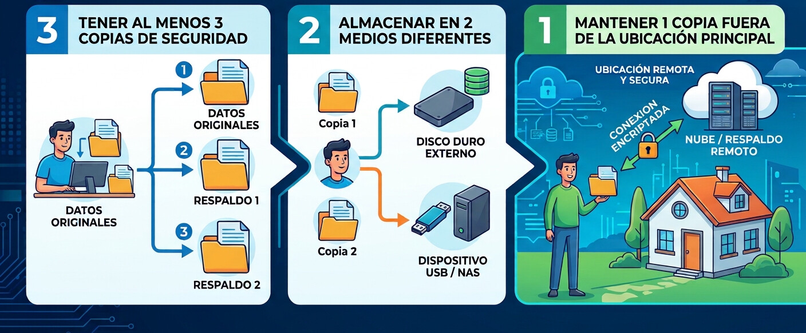

Siempre nos dijeron que lo que subes a internet es para siempre. Que ojo con lo que publicas, que se queda ahí eternamente, que un tuit de 2009 te va a arruinar la carrera. Es una de las mentiras más bonitas que nos contamos, porque tiene algo de verdad: **lo vergonzoso sí sobrevive**. Lo que de verdad quisieras conservar se muere solito, sin avisar y sin funeral.

Según [un estudio de Pew Research de 2024](https://www.pewresearch.org/internet/2024/05/17/when-online-content-disappears/), el 38 % de las páginas web que existían en 2013 ya no están disponibles. O dicho de otra forma: de cada diez páginas de hace una década, casi cuatro se esfumaron. Una cuarta parte de todas las páginas que existieron entre 2013 y 2023 desapareció, y más de la mitad de los artículos de Wikipedia (el 54 %) tiene al menos un enlace roto en sus referencias. Hasta la enciclopedia donde "todo está citado" cita cosas que ya no existen. (Y sí, el enlace de arriba también puede morir algún día. Si lo estás leyendo y sigue vivo, felicidades: eres parte de la minoría.)

Yo ya tengo mi lote en ese panteón. Buena parte del contenido de mis blogs anteriores se perdió. Mi perfil original de Facebook, con todo lo que había ahí, también. Y está Banubre Fansub: los animes que subtitulamos hoy solo sobreviven en sitios piratas, copias de copias de algo que ya era una copia, y los enlaces originales, los que yo mismo publiqué, están muertos. Lo único que queda de mi trabajo es **la versión pirata de mi trabajo pirata**. Hay una ironía ahí, pero prefiero no mirarla mucho.

Lo peor son los archivos que en teoría deberían existir. Están ahí, en una cuenta, en algún servidor, pero la cuenta fue bloqueada y recuperarla exige convencer a un humano de que existes. Spoiler: no hay humanos. Mis archivos están, probablemente, perfectamente a salvo, donde nadie, incluido yo, puede abrirlos. Es el mejor respaldo del mundo, nomás que sin llave.

Migrar este blog desde WordPress fue una autopsia. Las capturas de [mi reseña de Kokoro ga Sakebitagatterunda](/posts/el-corazon-quiere-gritar/) vivían en Photobucket, que ya no las sirve. Una imagen de Facebook que usé en otra entrada me devuelve un 403, que es la forma educada que tiene internet de decir "aquí ya no es". Y el [ensayo de Everth sobre tecnología educativa](/posts/ensayo-sobre-tecnologia-educativa/) apuntaba a un Drive donde ya no hay nada. Nadie lo hizo a propósito. Un servicio cambia sus reglas, otro cierra, alguien borra un archivo, y el enlace que usaste queda apuntando a la nada. No hubo un villano; fue una muerte por mil descuidos.

Me salvó la API pública de WordPress, que todavía dejaba rescatar el texto de las entradas. Lo demás fue arqueología.

Aprendí a la mala, así que hoy trato de seguir la regla de respaldos **3-2-1**: tres copias de lo importante, en dos tipos de almacenamiento distintos, y una de ellas fuera de casa. No es emocionante, pero separa "perdí un disco" de "perdí todo".

<figure>

<figcaption>

La regla de respaldos 3-2-1

</figcaption>

</figure> Es el equivalente digital de usar el cinturón de seguridad: nadie presume de él, pero se nota el día que hace falta.

Este blog también es parte de la respuesta. Lo que escribo vive en archivos de texto que yo controlo, en un repositorio que puedo clonar y mover a donde quiera. Si mañana desaparece el hosting, lo vuelvo a publicar en otro lado en un par de horas. Es lo más parecido a la inmortalidad digital que he encontrado, y cuesta casi nada. Texto plano: el único formato que ha sobrevivido a todas las modas.

También uso la [Wayback Machine](https://web.archive.org/), que es una maravilla, pero no siempre sirve: a veces nunca guardó la página, a veces la guardó sin imágenes, a veces los videos no cargan. Confiar en ella como único respaldo es como confiar en que el vecino guardó una copia de tus llaves.

Así que sí, internet es para siempre. Hasta que deja de serlo, y casi nunca avisa. Lo único que de verdad garantiza que algo dure es que alguien tenga una copia y las ganas de conservarla. De preferencia, uno mismo.

Mientras tanto, voy a seguir publicando aquí y respaldando todo. Por si acaso. Algún día alguien va a buscar este post y va a encontrar un 404, y espero que al menos tenga la decencia de sentir algo.
