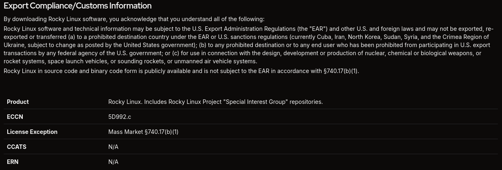

Hay avisos legales que existen para informar y avisos que existen para que, llegado el caso, alguien pueda decir _"yo ya lo advertí"_. El de Rocky Linux es de los segundos.

Andaba en la página de descarga, buscando el ISO como cualquier persona decente, cuando me topé con un texto que empieza así:

_"By downloading Rocky Linux software, you acknowledge that you understand all of the following"_.

O sea: con darle clic al botón de descarga ya acepté entender todo lo que viene después. Y lo que viene después es un bloque de jerga legal sobre exportaciones que me leí completo. Sí, así de emocionante es mi vida. Pero no me arrepiento, porque entre tanta letra había una contradicción bastante buena.

No soy abogado, ni pretendo serlo. Soy el tipo que lee los avisos legales por deporte, lo cual dice más de mí que del aviso. Pero cuando un texto se contradice solo, no hace falta ser abogado para notarlo.

El aviso dice que el software "puede estar sujeto" a las EAR —las regulaciones de exportación de Estados Unidos, por si alguien no las tiene en el radar— y que **no puede exportarse, reexportarse ni transferirse** a países prohibidos (hoy: Cuba, Irán, Corea del Norte, Sudán, Siria y la región de Crimea), a personas o entidades vetadas por el gobierno estadounidense, ni para el diseño o producción de armas nucleares, químicas o biológicas, cohetes o drones.

Hasta ahí, el aviso de exportación de manual. El tipo de texto que uno firma sin leer y sigue con su vida.

## El aviso se contradice

Pero el último párrafo dice esto:

> _"Rocky Linux in source code and binary code form is publicly available and is not subject to the EAR in accordance with §740.17(b)(1)."_

El bloque completo, en su hábitat:

El mismo aviso dice que no puedes exportar el software a ciertos países y, tres líneas más abajo, que el software **no está sujeto a las reglas de exportación**. Es como poner un letrero de "prohibido pisar el pasto" en un terreno que para empezar no tiene pasto.

Con eso en mente, me fijé en qué es exactamente lo que prohíbe: exportar, reexportar o transferir. No dice nada de usar el software, ni de descargarlo desde esos países. Podría discutirse si una descarga cuenta como "transferencia", pero ni siquiera hace falta, porque si el software está exento, la exención cubre también esa lectura. Un ISO es un binario publicado, así que le aplica lo mismo: descargarlo, grabarlo en CDs y regalarlos, o mandarlo a donde sea, queda dentro de lo que el propio aviso declara exento.

Y si alguien modifica Rocky Linux y lo redistribuye, la responsabilidad de esa versión recae en quien la modificó, no en el proyecto. Eso lo dice también la [guía de la Linux Foundation sobre controles de exportación](https://www.linuxfoundation.org/tools/understanding-us-export-controls-with-open-source-projects/): la exención cubre al proyecto, y quien redistribuye código modificado debe revisar su propio caso.

Fui a ver qué dice la sección que cita, la §740.17(b)(1), y resulta que [no habla de software publicado](https://www.law.cornell.edu/cfr/text/15/740.17). Es la _License Exception ENC_, un permiso para exportar productos de cifrado que ya fueron autoclasificados, y su texto **excluye** a los países de los grupos E:1 y E:2, los más restringidos. La exclusión del software publicado está en otra disposición.

El aviso mezcla dos regímenes legales y cita mal el que sostiene su propia exención. Para un texto cuyo único trabajo es decir la verdad sobre lo que se puede y no se puede hacer, eso importa. Es como citar el artículo equivocado en una tarea y esperar que nadie lo note.

## Entonces, ¿para qué sirve?

Para nada que le toque al usuario. Si el software está exento, la restricción no tiene a qué aplicarse. Lo único que queda es **dejar constancia**: las empresas con sede en Estados Unidos documentan que cumplen las reglas de exportación, y un aviso como este es la forma estándar de hacerlo. Si algún día lo pide una autoridad —el Departamento de Comercio con sus EAR, el Tesoro con las sanciones, el de Justicia en casos penales—, el aviso demuestra que alguien pensó en el asunto.

**Se cumple la norma para que el gobierno no te dé lata.** Ese es el propósito: callar a los _evil overlords_ de turno para que no molesten. Cumplir la ley no tiene nada de malo; el problema es que el aviso esté mal hecho.

El trámite no es del todo inofensivo, porque el aviso informa mal. Para entenderlo hay que saber qué es una exportación controlada, qué son las EAR, qué significa estar exento y cómo encajan las dos cosas. Casi nadie que llega a descargar un ISO sabe eso. Entre el tono de advertencia y la excepción escondida al final, alguien en Cuba o en Irán puede leerlo y pensar "mejor no, no vaya a ser" sin que el texto prohíba nada de eso.

Pongamos un ejemplo. Imaginen a Yosvany Hernández, en La Habana, a Reza Karimi, en Teherán, y a Pak Chol-su, en Pionyang (nombres inventados, personas comunes y corrientes), sin ningún vínculo con Estados Unidos, que quieren montar un servidor casero con Rocky Linux nomás para aprender. Aun si la transferencia estuviera realmente prohibida, quien respondería por ella sería quien lo distribuye, no ellos: una autoridad estadounidense no tiene a quién perseguir en la casa de Yosvany, ni en la de Reza, ni en la de Pak Chol-su. Lo más que les podría pasar es que un sitio les bloquee la IP, y eso es una barrera de acceso, no una sanción. O sea que las personas a las que el aviso más asusta son las que menos riesgo corren, y la que sí tiene que cumplir la regla es justo la que el aviso protege.

Además, el aviso no menciona qué otras reglas podrían aplicar fuera de la página. No sé si se omitió a propósito o por descuido. Da igual: quien lo lee se queda con la mitad de la historia.

Un aviso que prohíbe lo que declara exento, cita mal la sección que lo respalda y confunde a quien lo lee existe para que alguien, algún día, pueda decir _"yo ya lo advertí"_. Es un adorno administrativo: puro trámite, sin ninguna función real para el usuario.

Lo dejo aquí por si alguien más se lo topó y se preguntó lo mismo. Traducido, lo que dice el aviso es: _"no te preocupes, pero por si acaso te asustamos"_.

Y si de paso alguien de Rocky Linux lee esto: no es nada personal, el ISO está muy bonito. Pero cámbienle la cita, por favor.
