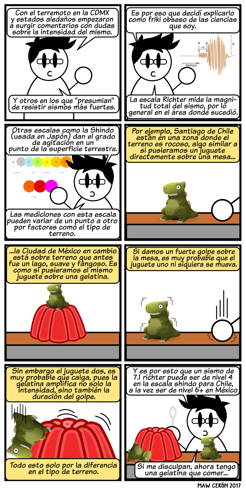

Todos ya conocemos la triste noticia del terremoto que devastó, la Ciudad de México, Puebla y Morelos el pasado 19 de Septiembre. Sin embargo algo que me llamó la atención fue el hecho de que después del terremoto se presentaron en las redes sociales muchos comentarios en los que se cuestionaba si la magnitud del sismo realmente fue de 7.1 pues lo habían sentido mucho mayor, e igualmente surgieron comentarios de otras latitudes "presumiendo" que un sismo de esa magnitud no les hacía ni cosquillas, que ellos habían resistido terremotos mucho más grandes.

Es por eso que me dí a la tarea de tratar de explicar, por qué un sismo de la misma magnitud puede no ser más que el simple susto en lugares como Chile y a la vez resultar mortales en México. Obviamente lo hice como mejor puedo hacerlo, con dibujitos...

