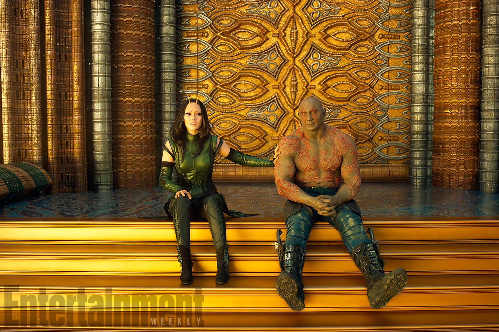
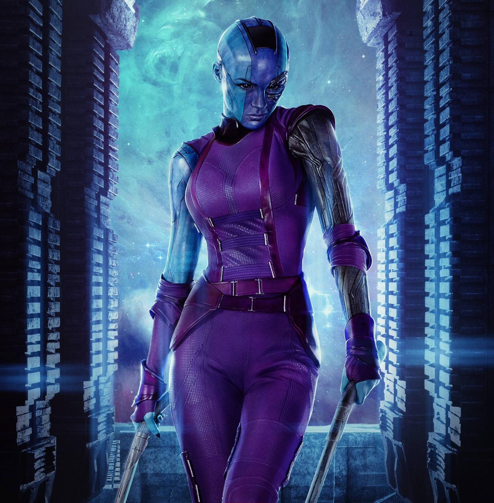
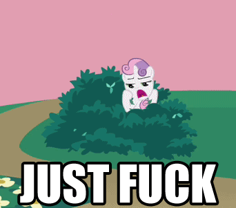

import Chat from '../../../components/Chat.astro';
import ChatMessage from '../../../components/ChatMessage.astro';

Ha pasado una semana desde el estreno de Guardians of the Galaxy (al menos en México), por lo que el periodo libre de spoilers ha terminado, así que veamos de forma rápida que hemos aprendido con esta película.

**GUARDIANS OF THE GALAXY ES GENIAL**. Quizá la trama es un poco confusa y abarca demasiadas cosas a la vez, lo de Ego como el padre de Quill y sus intenciones de dominar el universo, junto con el motín de parte de los Ravagers tienen sentido para el desarrollo de la trama, sin embargo la cazería por parte de los Sovereign me parece que ocupa espacio de más en la película, pero todo lo demás es simplemente grandioso, las escenas tomadas de los cómics fueron buenas y amé cada una de ellas, Baby Groot es la joya de la película, su escena de baile inicial --incluyendo el running gag de que Drax no lo ve bailar--, su incapacidad de comprender instrucciones y no aceptarlo con resultados hilarantes, y esa escena donde llora al casi morir aplastado por Ego... Si no lo amas es que no tienes corazón o hay algo muy malo contigo. La interacción de Drax y Mantis es perfecta, generan una complicidad encantadora y su tensión sexualmente tsundere por parte de ambos es muy divertida. Es curioso como la película puede hacer tantos chistes sexuales y mantenerse con clase...

Rocket es sin duda mi favorito y el personaje que más se desarrolla emocionalmente a lo largo de la película al entender que no tiene porque alejar a quienes lo rodean. Sin mencionar que me encanta lo sobre-protector y comprensivo que es con Baby Groot, sin duda una completa inversión de los papeles que vemos en la primera película.

## ¡¡¡Nebula es condenadamente sexy!!!

Además de lo obvio, descubrimos los verdaderos motivos de Nebula para querer matar a Gamora y Thanos, podemos resumirlo en que ella solo quiere un poco de amor una hermana, y la consigue al mejorar drásticamente su relación con Gamora, de la que también vemos algunos avances milimétricos para salir de la tsundere zone con Peter, en serio, en gran parte de la película literalmente quería gritar:

Si algo no me convenció demasiado fue la forma en que manejaron lo de convertir a Ego de papá del año a villano, literalmente fue algo así:

<Chat>
  <ChatMessage from="Ego">Amé a tu madre y odié dejarte</ChatMessage>
  <ChatMessage from="Peter">¡¡Quizá finalmente podamos ser una familia feliz!!</ChatMessage>
  <ChatMessage from="Ego">¡Claro! Solo necesitas ayudarme a matar a todos</ChatMessage>
  <ChatMessage from="Peter">¿Qué? ._.</ChatMessage>
  <ChatMessage from="Ego">Por cierto, yo maté a tu mamá</ChatMessage>
  <ChatMessage from="Peter">WHAT THE FU--- TU NO ERES DAVID HASSELHOFF</ChatMessage>
</Chat>

Pero quien se lleva la película es sin duda Yondu, no solo es Mary Poppins, se la pasa tirando profundas enseñanzas de vida durante toda la película a todos, el tipo no solo se redime, se vuelve un maldito héroe, EL MALDITO HÉROE para ser exactos. Si no hubiera salido la película de Logan, sería sin lugar a dudas el personaje del año.
