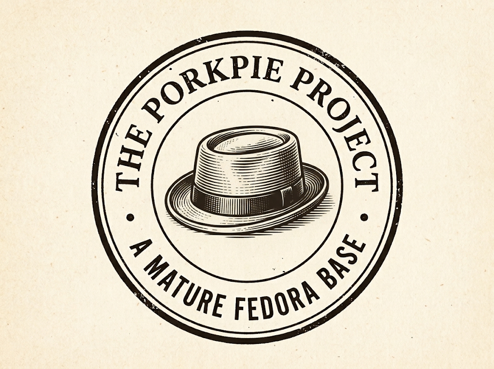

A mediados de septiembre salió la beta de Fedora 45, y andando por ahí (creo que en Reddit, si mal no recuerdo) me topé con varios comentarios de gente diciendo que *por fin* iban a poder instalar Fedora 44. Ya saben, esperar a que la versión madure un poco antes de dar el salto, y cuando por fin se siente lista resulta que ya viene la siguiente. Y al leer eso me vino una idea: "creo que hace falta un LTS para Fedora". La solté tal cual, como si se me acabara de ocurrir, y seguí con mi vida. Hasta que hace unos días, cuando me puse a trabajar en el blog (ya vieron el nuevo diseño, esta bien chicles bomba, ¿no?) descubrí que la idea no de un LTS para Fedora no era tan nueva en mi mente, de hecho **ya lo había escrito**. En enero de 2015. Hace once años. Me quedé un rato viendo la pantalla y preguntándome si eran inicios de Alzheimer.

El post se llama [¿Por qué Fedora necesita un LTS?](/posts/por-que-fedora-necesita-un-lts/) y lo que dice, resumido, es esto: *usé Fedora de la versión 13 a la 19, me fui a Linux Mint porque cambiar de versión cada cierto tiempo me quitaba un tiempo que ya no tenía, y seguiría usando Fedora si tuviera una versión de soporte largo.* 

Once años después, para mi sorpresa, sigo exactamente en el mismo punto. Lo curioso es que ni siquiera me acordaba.

El problema sigue siendo el mismo, Fedora saca una versión nueva más o menos cada seis meses, y cada versión se mantiene unos 13 meses. Cuando sale la versión N, la N-2 llega a su fin de vida unas cuatro semanas después. Hagan la cuenta: si quieres seguir recibiendo actualizaciones, **tienes que saltar de versión cada año, más o menos**, sí o sí.

Y no es que actualizar sea difícil. Hoy es bastante sencillo, mucho más que en la época de F13, y casi siempre sale bien. Pero "casi siempre" no es lo mismo que "nunca me tengo que preocupar". Es tener una cita en el calendario con tu propio sistema operativo cada año, y a mí, la neta, me da flojera. Mi problema en 2015 era el tiempo y mi problema hoy es el tiempo... y pa'cabarla de amolar ahora tengo menos, no más.

Y por qué quiero Fedora? Pues obviamente por el GNOME reciente, kernel reciente, Mesa reciente, PipeWire reciente, todo lo bueno que trae. En pocas palabras. Quiero lo moderno sin tener que reinstalar o actualizar la distro completa cada año. También quiero que regresen los nombres divertidos de los releases como Beefy Miracle. Fedora 45, así a secas, no emociona ni a mis pantunflas.

## "Ubuntu ya existe", ya sé

Sé lo que van a decir, porque yo mismo lo he dicho: para eso existe Ubuntu LTS, o CentOS Stream, o AlmaLinux, o Rocky. Y sí, existen, y son buenísimas para lo que son. Pero ninguna es "Fedora, pero más tranquila". Ubuntu LTS es conservadora a propósito, lo cual hace aún más extraño que cada vez necesite más RAM. Las demás están pensadas sobre todo para servidores, y eso lo comprobé en carne propia.

Hace un par de meses le di una oportunidad a Rocky Linux como workstation y, la neta, es bastante latosilla con cosas relativamente simples. Como servidor, en cambio, mis respetos. En el trabajo tengo una PC habilitada como servidor con Forgejo, Uptime Kuma, Fleet y MkDocs (porque en este trabajo [documento absolutamente todo](/posts/documenta-tu-codigo-por-el-amor-de-dios-documenta-tu-codigo/)), entre otros servicios, y lleva varios meses corriendo sobre Rocky sin una sola queja. O sea que no es mala en sí, simplemente no es para lo que yo la quería: un escritorio actual en mi laptop.

Hay un hueco, creo yo, entre "lo más nuevo de lo nuevo cada seis meses" y "lo suficientemente viejo para que nada se rompa".

## "Entonces usa un rolling release"

Esta es la otra pregunta obvia, y de hecho es la otra cara de la moneda: si lo que no quiero es estar actualizando la versión de la distro, un rolling release lo resuelve de raíz. No hay versiones, todo se va actualizando poco a poco, nunca tienes que dar "el salto".

El problema es justo ese, que todo se va actualizando. Pasas de una cita al año con tu sistema operativo a actualizar casi a diario, con el riesgo de que alguna actualización no salga como debe, le de la chiripiorca a tu equipo y te toque arreglar el desastre a ti. Y no niego que es divertido a veces, pero sin tiempo disponible solo sería cambiar un problema por otro.

Lo que yo busco es un punto medio: **ni tan viejo que canse** (*cof, cof... te estoy viendo, Debian*), **ni tan nuevo que desespere**. Por eso ni siquiera pido un LTS de cinco años como el de Ubuntu. Me conformo con dos añitos: lo suficiente para olvidarme del tema una buena temporada, sin quedarme tanto tiempo atrás que el software ya se sienta de otra época.

## Por qué no existe (y por qué entiendo que no exista)

En 2015 escribí que Fedora es un proyecto comunitario --aunque lo respalde RedHat-- y que un LTS necesita un equipo dedicado a darle soporte durante años, algo que las distros respaldadas por una empresa sí pueden pagar, y no es como que RedHat lo vaya a hacer. Incluso dije que probablemente Fedora nunca iba a tener uno. Pues bien: no lo tiene, y el panorama la verdad es que no ha cambiado mucho en ese aspecto.

Además hay algo que respeto: Fedora no es Ubuntu. Su razón de ser es ir adelante, probar cosas, empujar el software libre hacia el futuro. Un LTS iría un poco en contra de esa idea. No lo digo como excusa, lo digo porque entiendo que quien pide un LTS le está pidiendo a Fedora que traicione su propia filosofía.

## Mi desvarío mental

Dándole vueltas al asunto (y esto es más que nada un ejercicio mental, no un proyecto en serio, que quede claro), me puse a imaginar cómo se haría algo así sin pedirle permiso a nadie: una **derivada** de Fedora. No un "Fedora LTS", porque ese nombre promete demasiado, sino algo con identidad propia que deje claro de dónde viene. De hecho, hasta me inventé un nombre: *The Porkpie Project*. Porque el fedora es un sombrero y el porkpie también, y me pareció gracioso. Su lema sería algo como "Fedora, given time to settle".

La idea era sencilla: una base estable y madura, digamos usar el kernel de F43 cuando sale F45, y paquetes uno o dos releases (del paquete) atrás. Madura, pero no vieja. Fedora a la que se le dio tiempo de asentarse.

Eso sí, alguien tendría que hacerse cargo de revisar y dar mantenimiento a esos paquetes viejos de Fedora, y de crear los repositorios propios de Porkpie. El reto de verdad no sería técnico, sería organizativo: mantenerlo durante años y conseguir que la gente confíe en que no lo vas a abandonar.

Y es un desvarío mental porque si no tengo tiempo para estar actualizando Fedora, que a lo mucho me lleva un par de horas, mucho menos tengo tiempo para estar manteniendo repos... pero estaría chido que existiera. Ahí si alguien se quiere aventar el proyecto, tiene todo mi apoyo moral.

## Terminamos con lo mismo

Once años después sigo creyendo que Fedora necesita un LTS. No porque Fedora esté mal, sino porque la idea de un escritorio moderno que no te obligue a actualizar la distro cada año me sigue pareciendo valiosa. Y porque, si hay algo que me enseñó volver a leer mi propio post de 2015, es que esta no es una idea que me brotó de la cabeza. Es una idea que llevo cargando todo este tiempo.
