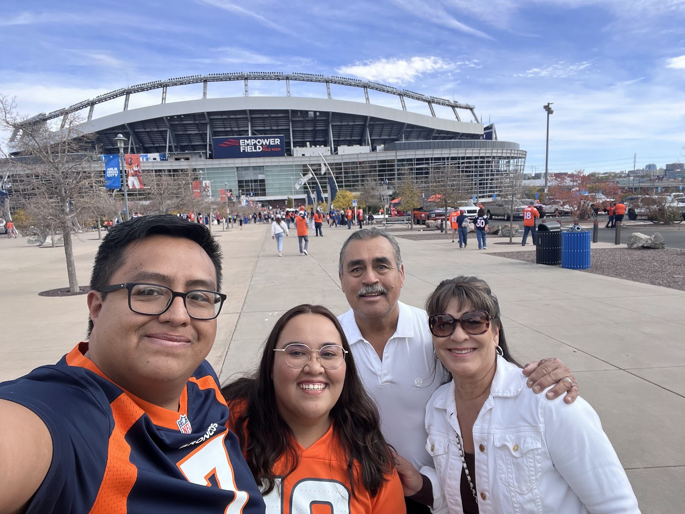
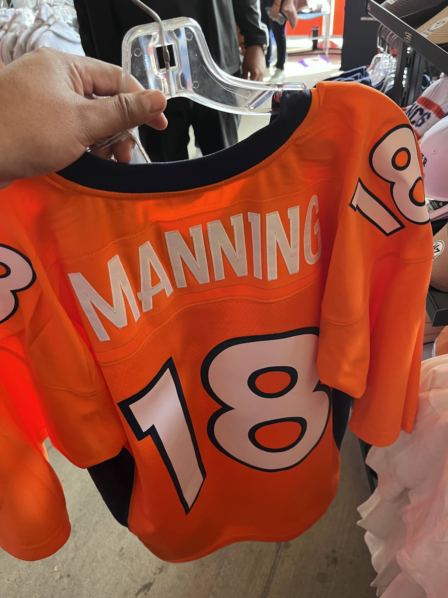
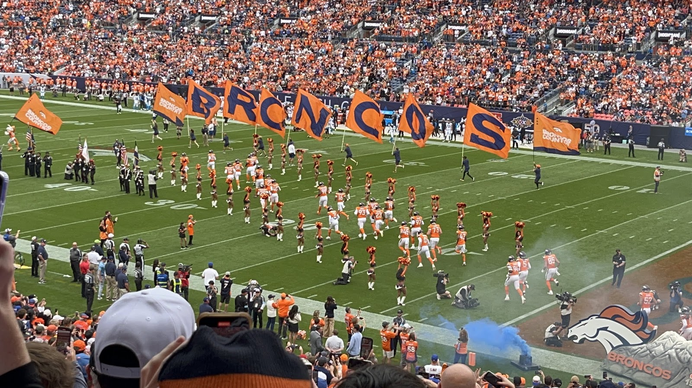
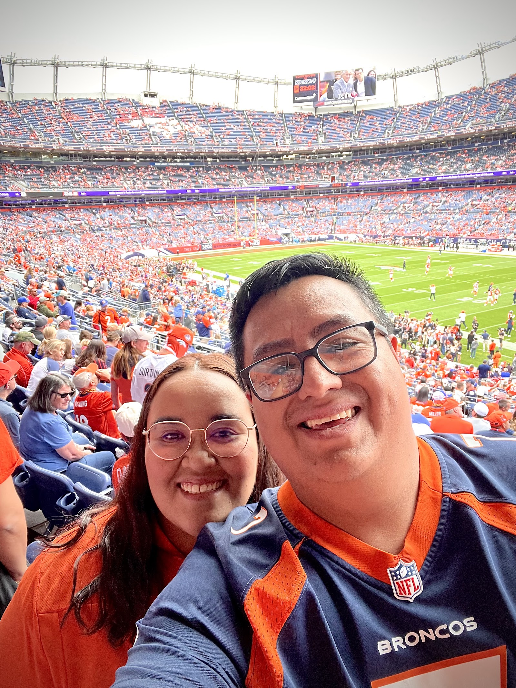
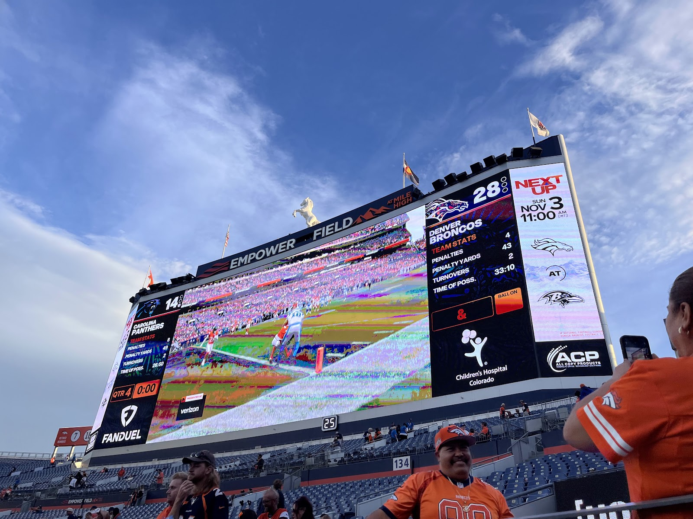
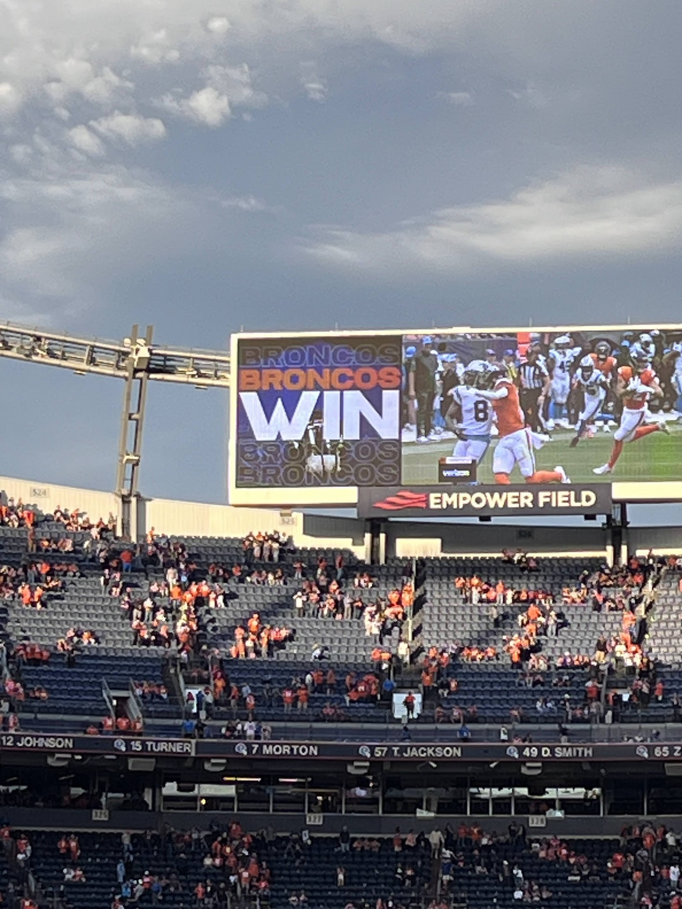
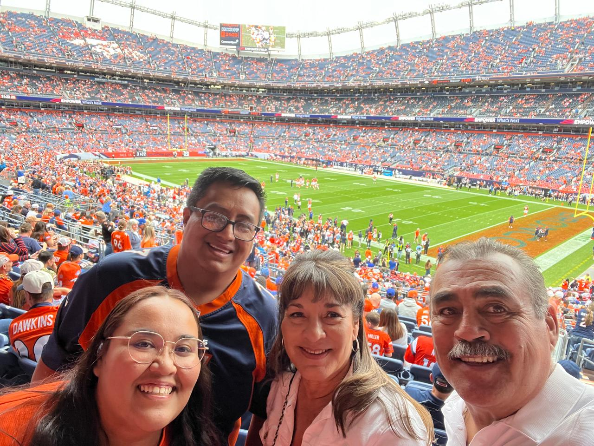
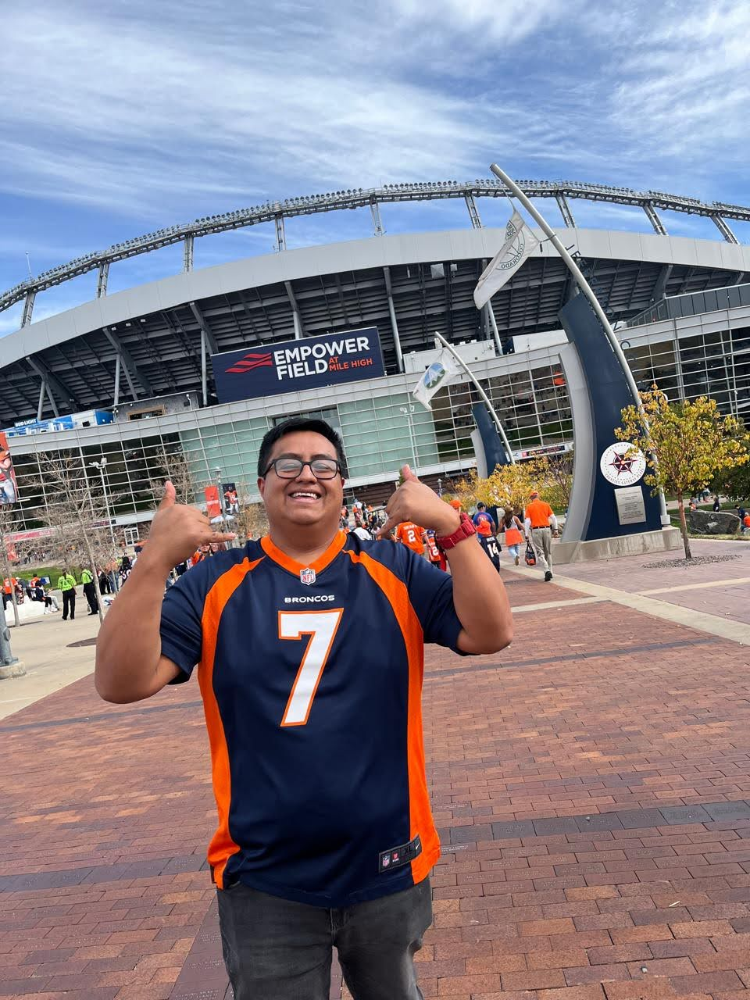

import poster from '../../../assets/images/posts/peregrinacion-mile-high/salida-poster.jpg';
import tdPoster from '../../../assets/images/posts/peregrinacion-mile-high/touchdown-poster.jpg';

## El Libro de Mile High

### Capítulo I: La profecía del niño y los colores sagrados

En el año de Nuestro Señor de mil novecientos noventa y seis, cuando aún contaba yo diez años de edad, me fue revelada la grandeza de los Denver Broncos.

Y aconteció que, sentado frente al televisor de mi morada en la Ciudad de México, contemplé a John Elway y a sus guerreros, ataviados con los colores del fuego y del cielo. Y algo se encendió en mi corazón, algo que ni los años ni las derrotas ni las tribulaciones habrían de extinguir.

Desde aquel día, el naranja y el azul fueron mis colores, Denver fue mi ciudad prometida y los Broncos, el equipo al que entregué mi fidelidad.

Mas había una condición impuesta por el destino: yo habría de amar desde lejos, pues grande era la distancia entre mi humilde morada y el sagrado campo de batalla conocido como Mile High.

Pasaron los años, y con ellos llegaron las victorias y las derrotas. Los Broncos conquistaron dos Super Bowls, y yo me regocijé. Después vino la sequía, y yo permanecí. Llegó Peyton Manning, como enviado de los cielos, y bajo su mando los guerreros de Denver alcanzaron nuevamente la gloria. Otro Super Bowl fue conquistado, y otra vez se escucharon cánticos de júbilo entre los fieles.

Mas luego vinieron años de oscuridad, largas temporadas de aflicción, cambios de señores y nuevas promesas de redención. Y aunque los días se hicieron años y los años se hicieron décadas, una sola plegaria permaneció intacta en mi espíritu:

**Que algún día pudiera contemplar con mis propios ojos a los Broncos jugar en su propia tierra.**

Veintiocho años transcurrieron desde aquella primera revelación hasta el cumplimiento de mi anhelo.

Moisés condujo a su pueblo durante cuarenta años por el desierto, alimentándose del maná que descendía de los cielos. Yo aguardé veintiocho años para contemplar la tierra prometida, y ni siquiera recibí semejante misericordia: a falta de maná, hube de conformarme con unas míseras papas del OXXO. En verdad os digo que, comparados con mi peregrinación, los cuarenta años de Moisés fueron un simple paseo dominical.

Y que nadie diga que la fe no exige sacrificios.

### Capítulo II: Los mensajeros de la providencia

Mas no fue por medio de una expedición cuidadosamente planeada que se abrió el camino hacia la tierra prometida. Porque los designios de la providencia suelen manifestarse cuando menos los espera el hombre.

Nuestro viaje tenía un propósito mucho más terrenal: visitaríamos a la familia de Lucy, mi esposa, en El Paso, Texas. El vuelo de León a Ciudad Juárez ya estaba comprado, pues León es la ciudad más cercana a Aguascalientes, donde habito, desde la cual podíamos volar directamente a Juárez.

Hasta entonces, todo marchaba conforme a los planes de los mortales.

Pero he aquí que, pocos días antes de nuestra partida, llegó la noticia que habría de cambiarlo todo.

La tía Mary, residente en El Paso, por solicitud de mi amada esposa --cuya palabra no conviene ignorar-- había conseguido boletos para el encuentro del domingo 27 de octubre de 2024, en el cual los Denver Broncos se enfrentarían a los Carolina Panthers. Y no solo eso: ella y el tío César nos acompañarían en aquella santa expedición.

¿Fue la tía Mary un instrumento de la providencia? ¿Descendió un ángel para anunciarme que mis días de peregrinación estaban por terminar? ¿Movió el espiritu de Pat Bowlen las piezas de su tablero celestial para que un simple mexicano pudiera contemplar a sus Broncos?

No me corresponde a mí responder semejantes preguntas.

Lo que sí puedo atestiguar es que, apenas terminé de escuchar la noticia, me regocijé.

Porque hay llamados que el hombre debe meditar, y hay llamados ante los cuales solo existe una respuesta digna: amén.

### Capítulo III: El éxodo hacia la tierra del naranja y el azul

Llegamos a El Paso la noche del sábado 26 de octubre. El descanso fue escaso, pues la emoción ya había comenzado a robarme el sueño. Y mientras la ciudad dormía, nosotros nos levantamos de madrugada y partimos hacia el aeropuerto.

Nuestro destino era Denver.

Aquel domingo no sería un domingo cualquiera. Era día de juego.

Al llegar, nos registramos en el hotel y, tras dejar nuestras pertenencias, probar alimentos y reponer fuerzas, nos dispusimos a emprender la jornada. Mas antes de dirigirnos al templo, aún quedaban algunas etapas en nuestro peregrinaje. Porque hasta la tierra prometida exige paciencia, y no todo camino sagrado conduce directamente a su destino.

Fue entonces cuando el tío César, hombre de conocimiento y sabiduría práctica, nos condujo hacia los dominios de Walmart.

### Capítulo IV: Los mercaderes del templo y el diezmo del peregrino

Mas antes de entrar en la tierra sagrada, era menester realizar una parada en los dominios de Walmart, pues he aquí que los mismos señores que gobiernan sus vastos reinos comerciales son también dueños de los Denver Broncos. Y así, antes de rendir culto en el templo, el peregrino habría de pasar por las arcas de sus propios señores, aunque en esta ocasión el diezmo se pagaría a cambio de gorras, camisetas y otros objetos de devoción.

El tío César, hombre de conocimiento y sabiduría práctica, nos reveló un secreto reservado para quienes conocen los caminos del mundo: allí encontraríamos mercancía de los Broncos a precios mucho más favorables que los ofrecidos dentro del estadio.

Y así fue.

Porque incluso en una peregrinación sagrada conviene ejercer la prudencia, especialmente cuando el peregrino tiene una tarjeta bancaria y ninguna intención de usarla con moderación.

Grande fue mi asombro al contemplar los estantes repletos de gorras, playeras, vasos y demás reliquias de los guerreros de Denver. En México, hallar mercancía de los Broncos no es tarea sencilla; mas allí, ante mis ojos, se extendía un verdadero jardín de abundancia naranja y azul.

Y tomé de sus estantes cuanto mi corazón consideró necesario para la ocasión.

Así pues, el peregrino rendía tributo a los señores de su equipo antes de llegar al templo, aunque el diezmo fuese pagado en una sucursal comercial y no en una casa de oración.

Y si alguien pregunta por qué no esperé a comprarlo todo dentro del estadio, que sepa que hasta los hombres de fe deben cuidar sus finanzas.

### Capítulo V: La tierra prometida se revela ante mis ojos
Durante un breve recorrido por el Downtown, en el automóvil que habían alquilado los tíos, Denver se mostró ante nosotros con sus calles, sus edificios y sus montañas a la distancia.

Mas confieso que apenas presté atención.

Mis ojos miraban, pero mi mente estaba en otra parte. Las conversaciones llegaban a mis oídos, pero no siempre alcanzaban mi entendimiento. El mundo seguía su curso, ajeno a la tormenta que rugía dentro de mí.

Porque el cuerpo había llegado a Denver, sí; pero el espíritu llevaba veintiocho años allí.

A unas cuantas millas aguardaba el templo.

Empower Field at Mile High.

Allí estaba.

No en una pantalla. No en una fotografía. No en los sueños que durante tantos años había construido mi imaginación. Estaba ante mí, enorme y real, alzándose sobre la tierra de Colorado como una fortaleza consagrada al deporte y a la gloria.

Y cuando lo vi, mi corazón comenzó a golpear con tal fuerza que por un instante creí escuchar en mi pecho el estruendo de setenta mil tambores.

<figure>

<figcaption>

Lucy, la tía Mary, el tío César y yo, frente al templo

</figcaption>

</figure>

El estadio había abierto sus puertas en 2001 y había llevado distintos nombres a lo largo de los años: Invesco Field, Sports Authority Field, Broncos Stadium y, finalmente, Empower Field at Mile High. Mas para sus fieles, para aquellos que llevan el naranja y el azul en el alma, su nombre verdadero nunca ha cambiado.

Mile High.

Una milla sobre el nivel del mar. Una milla más cerca de los cielos, diría algún predicador; aunque la altitud no garantice milagros, como bien pueden atestiguar los aficionados que han visto a su equipo sufrir derrotas inexplicables.

Entramos al estadio y visitamos la tienda oficial, cuyos anaqueles representaban una tentación contra la cual mi voluntad estaba mal preparada para luchar.

Salí de allí cargado de tesoros: una sudadera, un jersey réplica de Peyton Manning, fabricado por Mitchell & Ness, en naranja y correspondiente a la versión de jugador retirado de 2015, además de otras reliquias cuyo valor exacto prefiero mantener entre el Señor y mi cuenta bancaria.

<figure>

<figcaption>

El jersey de Peyton Manning

</figcaption>

</figure>

Y me llevé también el pin oficial del día del partido, pequeña pieza de metal que habría de convertirse en testigo material de aquella jornada extraordinaria.

Porque el oro se pierde, las riquezas se agotan y las tarjetas de crédito eventualmente cobran sus deudas; mas los recuerdos de un sueño cumplido permanecen.

Y entonces, con mis tesoros en las manos y el estadio ante mí, comprendí que el peregrinaje estaba a punto de alcanzar su momento más glorioso.

### Capítulo VI: La entrada de los elegidos

Llegó la hora.

Las gradas estaban llenas, los cánticos se elevaban y el aire vibraba con la impaciencia de una multitud que aguardaba la aparición de sus guerreros.

Y de pronto, las luces, el humo y el estruendo anunciaron que el momento había llegado.

Los jugadores de Denver emergieron del túnel y se dirigieron al campo mientras una nube se levantaba a su alrededor. Supongo que era hielo seco, aunque en aquel instante cualquier explicación científica habría resultado insuficiente para describir lo que mis ojos contemplaban.

Setenta mil voces se alzaron en una sola. El naranja se extendía por las tribunas como un incendio que ningún viento podría apagar. Los guerreros avanzaban hacia el campo y el estadio entero se puso de pie.

<figure>

<figcaption>

Banderas con las letras de BRONCOS y humo azul sobre el campo

</figcaption>

</figure>

Y yo, que había esperado veintiocho años para presenciar aquella escena, comprendí que no estaba soñando.

Era real.

<figure>

<video class="h-auto w-full" controls preload="metadata" poster={poster.src} src="/videos/mile-high-salida-del-equipo.mp4"></video>

<figcaption>

El humo y las banderas antes de que saliera el equipo

</figcaption>

</figure>

**Y lloré.**

No derramé una lágrima discreta ni fingí que algo se me había metido en el ojo. Lloré como lloran los hombres cuando la vida les concede, después de una espera interminable, aquello que durante años creyeron reservado para otros.

Lloré por el niño de diez años que había contemplado a John Elway desde la distancia. Por cada temporada de esperanza, por cada derrota soportada, por cada vez que imaginé cómo sería estar allí sin saber si algún día llegaría a descubrirlo.

Y lloré porque, por fin, estaba allí.

No sentí vergüenza. No pedí disculpas. No había nada de lo cual avergonzarse.

Mi esposa Lucy, sin embargo, encontró en aquel momento una oportunidad que no ha dejado pasar hasta el día de hoy.

—Yo que pensaba que yo era lo mejor que te había pasado en la vida —me dijo, en tono de broma.

<figure>

<figcaption>

Lucy y yo, minutos antes de que empezara el juego

</figcaption>

</figure>

Y quede asentado en este libro que jamás negué semejante afirmación.

Porque una cosa es amar a tu esposa y otra muy distinta es intentar explicarle a alguien lo que significa cumplir un sueño que comenzó cuando todavía eras un niño.

Aquel día, los Broncos salieron al campo y un hombre adulto lloró en las gradas.

Y si eso no es motivo suficiente para dar gracias, no sé qué lo sea.

### Capítulo VII: El milagro sobre el campo

Mas no habíamos viajado hasta Denver únicamente para contemplar el templo y derramar lágrimas. También había un partido por disputarse, y los guerreros debían demostrar que nuestra fe no sería puesta a prueba en vano.

Los Broncos se enfrentaban a los Carolina Panthers, y el encuentro comenzó con una señal ominosa: los visitantes tomaron la ventaja, colocando el marcador siete puntos contra cero.

Y por unos instantes, la angustia se apoderó de mi espíritu.

¿Acaso habíamos atravesado fronteras, vencido el cansancio y llegado hasta la tierra prometida solo para contemplar una derrota? ¿Sería aquella la prueba definitiva del peregrino? ¿Me correspondía presenciar en vivo una de esas tardes que los aficionados prefieren olvidar?

Pero no.

Los Broncos comenzaron a responder.

Bo Nix, el joven mariscal de campo, condujo el ataque con firmeza y terminó la jornada con 284 yardas por aire, sin pérdidas de balón. Courtland Sutton atrapó ocho pases para sumar cien yardas, mientras Patrick Surtain II interceptaba un envío de Bryce Young.

Y poco a poco, la balanza se inclinó a favor de los nuestros.

El equipo encontró su ritmo. La defensa resistió. El ataque avanzó. Y el marcador fue creciendo en favor de Denver, hasta que las dudas cedieron su lugar a la esperanza y la esperanza se convirtió en júbilo.

<figure>

<video class="mx-auto max-h-[32rem] w-auto max-w-full" controls preload="metadata" poster={tdPoster.src} src="/videos/mile-high-touchdown.mp4"></video>

<figcaption>

Touchdown de los Broncos, visto desde nuestros asientos

</figcaption>

</figure>

Al término de la batalla, el marcador proclamaba la victoria de los Broncos por veintiocho puntos contra catorce.

**Denver 28. Carolina 14.**

<figure>

<figcaption>

El marcador, ya con la ventaja de Denver

</figcaption>

</figure>

<figure>

<figcaption>

Broncos Win

</figcaption>

</figure>

Y los fieles pudieron regocijarse.

Porque no es lo mismo ver ganar a tu equipo desde el sofá de tu casa que presenciar la victoria con tus propios ojos, rodeado de miles de personas que comparten tus colores, escuchando el rugido de las gradas y sintiendo que, por unas horas, formas parte de algo mucho más grande que tú mismo.

Aquella tarde no solo vi jugar a los Broncos.

Vi ganar a los Broncos.

En Mile High.

En mi primera visita.

Si aquello no fue un milagro, al menos fue una de las bendiciones más grandes que me ha concedido la vida.

### Capítulo VIII: La torre de Babel y el idioma de los aficionados

Mas no todo cuanto aconteció aquel día puede explicarse mediante estadísticas, jugadas o anotaciones.

Porque mientras yo permanecía absorto en el espectáculo, incapaz de apartar los ojos del campo, mi esposa Lucy protagonizaba su propio encuentro.

Alguien se acercó a conversar con ella.

Y conversaron.

O, mejor dicho, aquella persona habló con gran entusiasmo, mientras Lucy escuchaba atentamente, sonreía y asentía con admirable cortesía.

Había un pequeño inconveniente: Lucy no entendió una sola palabra.

Mas no por ello flaqueó su espíritu. Permaneció firme, sonriendo y asintiendo durante un buen rato, como si comprendiera cada argumento, cada anécdota y cada revelación que le era transmitida.

Y así fue como, lejos de los campos de batalla y de las grandes gestas deportivas, se manifestó otro prodigio digno de quedar registrado en estas páginas.

Porque si algo he aprendido durante los años de matrimonio es que la comunicación no siempre requiere comprender el idioma del interlocutor.

Es el mismo talento que emplea Lucy cuando me escucha explicar las reglas del *holding*.

En verdad os digo que algunas personas poseen dones que ni los más sabios entre nosotros alcanzaremos jamás a comprender.

### Capítulo IX: El regreso del peregrino

Y cuando el encuentro terminó, llegó la hora de abandonar la tierra sagrada.

Nos despedimos del estadio, de sus gradas y de aquella ciudad que, aunque habíamos esperado tantos años para conocer, apenas habíamos tenido tiempo de recorrer. Mas no era aún el fin de nuestro viaje, pues nuestra peregrinación tenía otros propósitos y El Paso todavía nos aguardaba.

Y así, al día siguiente, emprendimos el camino de regreso, dejando atrás Denver y su templo, mas no para volver de inmediato a nuestros hogares. Primero retornamos a El Paso, donde permanecimos varios días, cumpliendo con la visita que originalmente nos había llevado hasta aquellas tierras.

Porque una cosa era haber cumplido el sueño de contemplar a los Broncos en su sagrado recinto, y otra muy distinta dar por concluido el viaje. Y así, después de aquellos días en El Paso, llegó finalmente la hora de emprender el último tramo del camino y regresar a casa, llevando con nosotros los recuerdos de una aventura que había tardado veintiocho años en hacerse realidad.

El peregrino regresaba a su morada.

Llevaba consigo las bolsas de sus compras, el pin del partido y unas cuantas fotografías que, aun hoy, bastan para devolverme a aquella tarde. Pero llevaba también algo que no cabía en el equipaje ni podía comprarse en ninguna tienda oficial: el recuerdo imborrable de haber cumplido un sueño que me había acompañado durante casi tres décadas.

Y doy gracias a la tía Mary, por los boletos que abrieron las puertas de la tierra prometida; al tío César, por su sabiduría comercial y por guiarnos hasta los tesoros de Walmart; y a Lucy, por acompañarme en aquella aventura y por tolerar a un hombre adulto que lloraba sin pudor mientras sus jugadores salían al campo.

<figure>

<figcaption>

Los cuatro en nuestros asientos

</figcaption>

</figure>

Y doy gracias, también, a aquel niño de diez años que, en 1996, se sentó frente a un televisor y decidió que aquellos hombres vestidos de naranja y azul serían su equipo.

<figure>

<figcaption>

El niño de diez años, veintiocho años después

</figcaption>

</figure>

Gracias por mantener viva la esperanza cuando la distancia parecía insuperable. Por permanecer fiel durante los años de sequía. Por celebrar los triunfos y soportar las derrotas. Por no abandonar el sueño, incluso cuando parecía pertenecer a una vida que nunca habría de llegar.

Porque a veces los sueños tardan años en cumplirse. A veces requieren paciencia, sacrificios y una buena dosis de suerte. Y a veces, cuando menos lo esperamos, la vida nos concede la oportunidad de regresar a aquel lugar donde comenzó todo y decirle al niño que fuimos:

**Lo logramos. Llegamos hasta aquí.**

Veintiocho años después de aquella primera revelación, el peregrino había contemplado el templo, había visto a sus guerreros salir al campo y había presenciado su victoria.

Y regresó a casa con el corazón lleno.

### Epílogo: La palabra del peregrino

Así concluye el testimonio de mi peregrinación a Mile High.

Que quede escrito para los que vinieron antes y para los que vendrán después; para los que llevan décadas alentando a los Broncos y para los que apenas comienzan a descubrir el significado de estos colores.

Que nadie se avergüence de amar un equipo. Que nadie se burle de los sueños que parecen absurdos. Que nadie le diga a un niño que algún día tendrá que abandonar aquello que le hace feliz.

Porque uno nunca sabe cuándo tendrá la oportunidad de cumplir una promesa que se hizo a sí mismo hace tantos años.

Y cuando esa oportunidad llegue, que encuentre al peregrino preparado, con el pasaporte en regla, el boleto en la mano y suficiente espacio en la maleta para toda la mercancía que pueda comprar.

En cuanto a mí, ya he visto Mile High. Ya he escuchado su rugido. Ya he llorado entre sus gradas. Y he visto a mis Broncos vencer.

No sé cuándo volveré a pisar aquella tierra, ni cuántos años habrán de transcurrir antes de que el camino vuelva a abrirse ante mí.

Pero sé que regresaré a ese día cada vez que mire el pin del partido, cada vez que me ponga aquella sudadera y cada vez que recuerde que, por unas horas, el sueño de un niño se convirtió en la realidad de un hombre.

Y si algún día mis descendientes preguntan por qué el naranja y el azul ocupan un lugar tan importante en estas escrituras familiares, que alguien les lea este relato.

Porque hay historias que merecen ser contadas, y hay milagros que merecen ser recordados.

Este es el testimonio de un peregrino.

<figure>

<figcaption>

Los cuatro en nuestros asientos

</figcaption>

</figure>

Aquí termina el Libro de Mile High.

**Amén.**

Y ahora, si me disculpan, iré por una cerveza.
