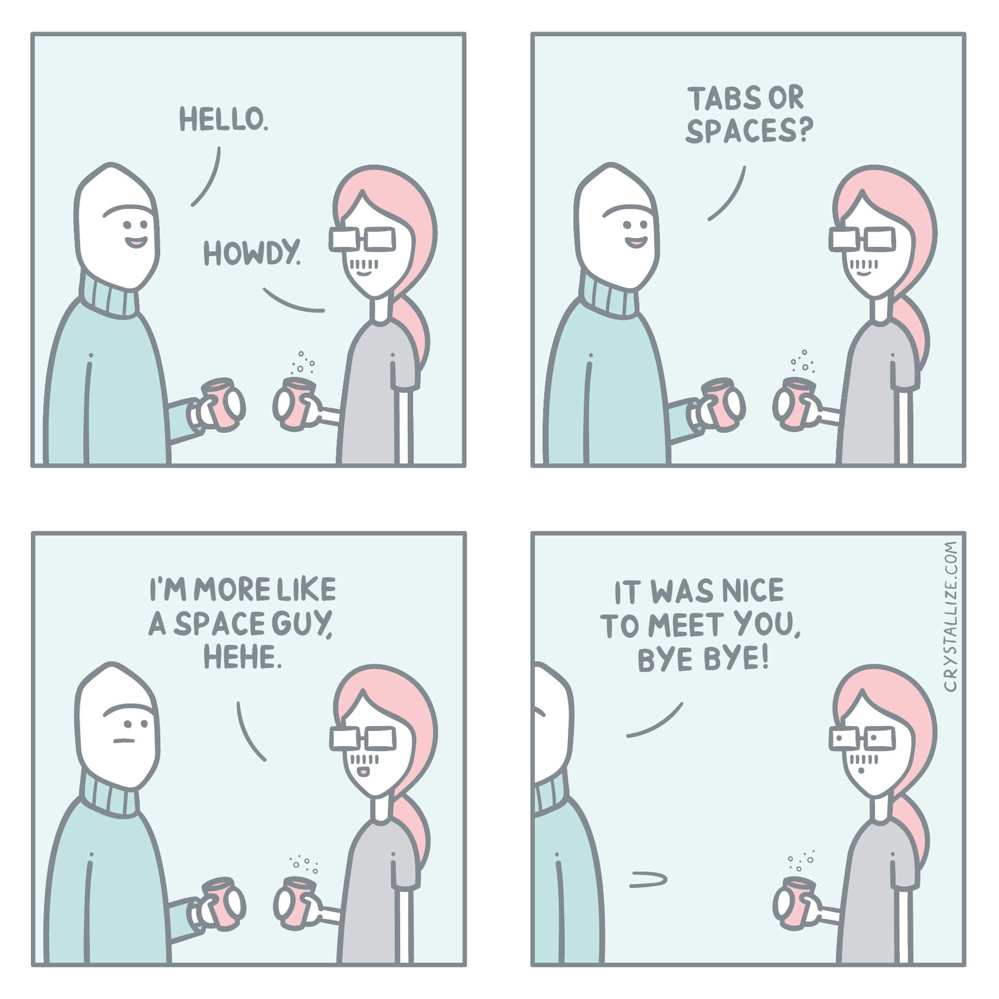

Sepan cuantos este escrito leyeren que en el reino de los editores hubo una vez paz grande, hasta que un hombre de buen talante, sin malicia ninguna, dijo en medio de la oficina: «Y vos, ¿cuál usáis, tabulaciones o espacios?». Y se partió luego la compañía en dos, como si un hacha cayera sobre la mesa: de una parte los que sacaban estandartes y cánones, de otra los que juraban dejar la hueste, y en medio, bien apartado del pleito, el que no tenía qué ver en el asunto, sirviéndose sus avellanas. Y no es cosa nueva: así feneció la lid del _Capitán América_ con el _Hombre de Hierro_, que a ninguno mudó de bando con sus razones, y así tornamos nosotros cada año al campo como si hubiera premio.

Y os digo que la respuesta ya está escrita, aunque depende del reino donde estéis. En Python, la guía de la gaya ciencia (PEP 8) manda espacios, cuatro por cada grado de sangrado. En PHP, los fueros de la cofradía (PSR-2 y su sucesor PSR-12) otrosí mandan cuatro espacios y vedan las tabulaciones, so pena de mal parecer. En Go es al revés: `gofmt`, el escribano del rey, pone tabulaciones y no os demanda consejo (**cero** opciones de adobo, un señorío benévolo, y no os miento).

Y en los Makefile la tabulación no es ya opinión, sino ley: las líneas de la receta han de comenzar con ella, y si ponéis espacios os sale un error tan oscuro que lo aprendéis a palos y lo recordáis hasta en el lecho de la muerte (y si nunca os acaeció, o no habéis usado `make`, o sois de los que copian y pegan sin mirar, que a vosotros os veo).

_Hizo este cómic [Crystallize](https://crystallize.com/comics/tabs-vs-spaces)._

Los defensores de las tabulaciones tienen una razón que no es necia: una tabulación es _un grado de sangrado_, no un número de columnas, y así cada cual adoba su editor para verla de dos, de cuatro o de ocho, sin tocar el escrito. —Y aquí salgo del cuento, porque este es el único punto del pleito que de verdad importa: hay gente que necesita indentaciones más anchas, o más angostas, para leer cómoda. Eso no es preferencia de nadie, es acceso.— Los del bando de los espacios responden con lo de siempre: que el código se ve igual en cualquier parte, que los diffs no se descuadran y que ninguno puede mezclar tabs con espacios sin dejarlo todo tuerto. Aunque, eso lo hace cualquiera con un editor mal adobado, y no habéis de culpar a la tabulación, sino a la mano.

Mi parte favorita de toda esta guerra es, sin duda, la pesquisa que hicieron en Stack Overflow en el año de 2017. David Robinson, hombre de buena memoria, miró los hechos de [28,657 maestros de la obra](https://stackoverflow.blog/2017/06/15/developers-use-spaces-make-money-use-tabs) que respondieron a la pregunta: el 40.7% era del bando de las tabs, el 41.8% del de los espacios, y los demás, un poco de cada uno (los del justo medio, que así los llamo yo).

Y de los que otrosí dijeron cuánto ganaban, la mediana de los de espacios era de 59,140 dólares, contra 43,750 de los de las tabs: quince mil dólares al año de diferencia. Y antes de que corráis a hacer _find and replace_ por todo vuestro repositorio y pidáis al señor un aumento: el mismo autor dice que no es conclusión firme, que puede ser por la tierra o por la lengua. Mudaros a los espacios no os alzará el sueldo. Mas lleváis ya un dato más para la próxima lid.

Yo, a la verdad, ya no lidio. En Go no tengo elección, que `gofmt` decide por mí y a estas alturas ni lo siento (así van mis obras, como [lazyftp](/posts/lazyftp-como-filezilla-pero-en-la-terminal/)). Y en PHP el fuero manda espacios y fenece la contienda. Que escojáis tabs o espacios poco se me da; lo que me quita el sueño es que lo escoja **una herramienta** y no la memoria del último que tocó el escrito. Es la misma razón de los linters que ya defendí [por aquí](/posts/documenta-tu-codigo-por-el-amor-de-dios-documenta-tu-codigo/): lo que se hace ley de la tierra dejó de ser pleito. Un `.editorconfig` en la raíz, un formateador en la puerta, y loado sea Dios. Ninguno se enoja con una máquina (todavía).

Y esto os ruego, por la fe que me debéis: si algún día me vieren mezclando tabs y espacios en un mismo escrito, tómeseme el teclado y no me lo devuelvan.
